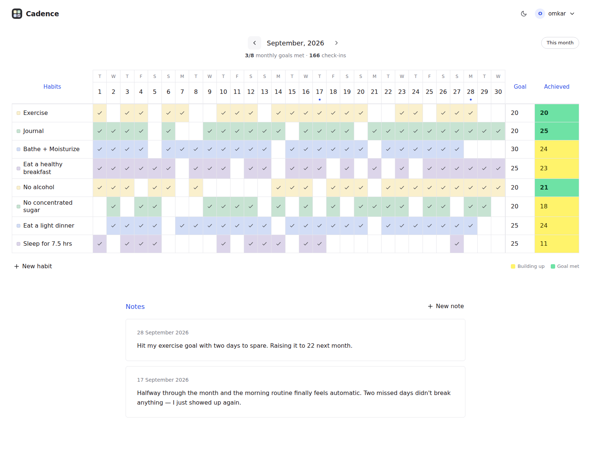
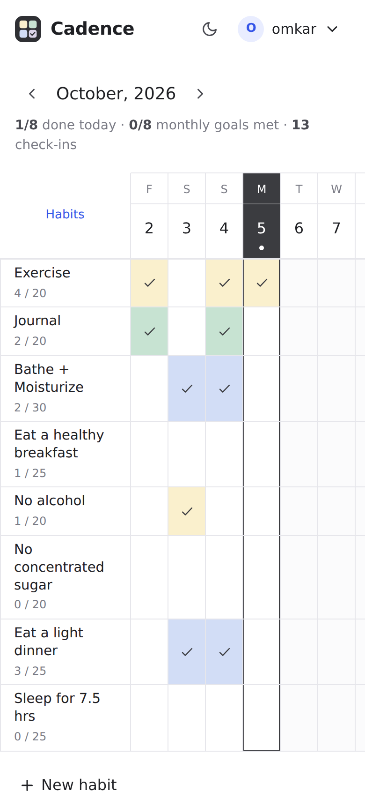
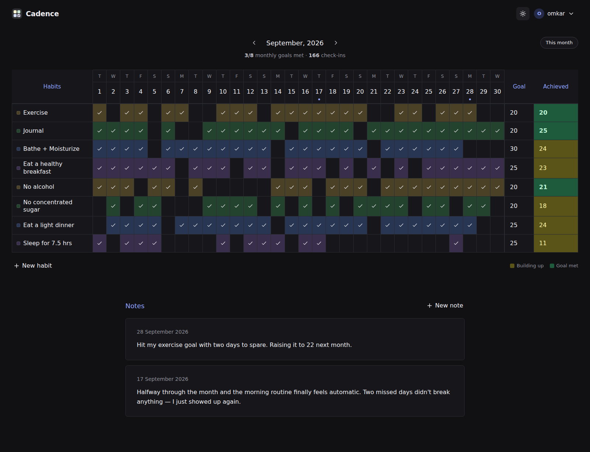
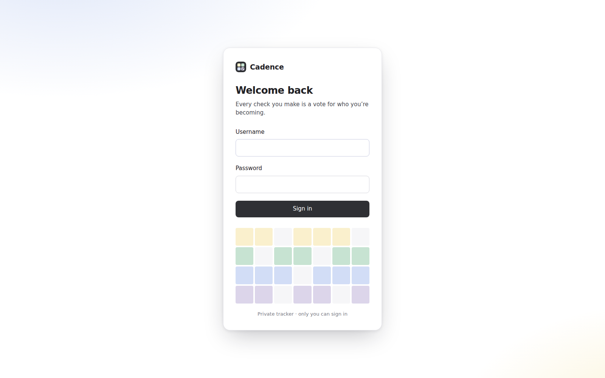

# Cadence

A private, self-hosted monthly habit tracker for one person: you.

The tracking model follows [dailyhabits.xyz](https://www.dailyhabits.xyz): a whole month on one screen, a **monthly goal per habit instead of a fragile streak**, and dated notes for reflection. Cadence adds a proper login, so the tracker can live on the public internet and still be yours alone.



| Mobile | Dark | Sign in |
| --- | --- | --- |
|  |  |  |

## Features

**Tracking**
- Month grid: one row per habit, one column per day. Tap a cell to check it off; future days are locked.
- Flexible goals: each habit has a "times per month" target. The Achieved column turns green once you hit it.
- Notes: dated reflections under the grid, with a dot on each day header that has a note.
- Eight pastel colors, reordering ("stacking"), archive and restore, delete.
- Archived habits keep showing in the past months where you used them, so history stays intact.
- Month navigation with `←` / `→`, `T` for this month, `N` for a new habit. The month lives in the URL (`/#2026-10`).
- A short message when you reach a monthly goal or finish every habit for the day.
- JSON export and import for backups.
- Installable on a phone home screen (web app manifest + icons).

**Authentication, built for a single owner**
- One account. It's created once through `/setup`, which needs a one-time token that only shows up in the server log, so nobody else can claim a fresh deployment.
- Passwords hashed with scrypt (Node's built-in crypto).
- Sessions use random 256-bit tokens. The cookie is `HttpOnly`, `SameSite=Lax`, and `Secure` over HTTPS. Only a SHA-256 of each token is stored, so a copied database can't be replayed as a login. Sessions slide for 30 days.
- Optional two-factor authentication (TOTP, RFC 6238) with any authenticator app. Codes can't be reused.
- Brute-force protection: after 5 failed sign-ins an address is locked out for 15 minutes.
- CSRF protection: every state-changing request needs a same-origin-only header, and requests marked `Sec-Fetch-Site: cross-site` are rejected.
- A strict Content-Security-Policy (no inline scripts or styles, no third-party origins), `X-Frame-Options: DENY`, `nosniff`, `no-referrer`, and HSTS over HTTPS.
- Settings page: change your password (other devices get signed out), turn 2FA on or off, see signed-in devices and sign them all out.
- Command-line recovery for a forgotten password or a lost authenticator.

**Zero dependencies**: Node's built-in `http`, `crypto` and `node:sqlite`. There's no `npm install`, no build step, and no third-party code.

## Quick start

You need Node.js **22.13 or newer**.

```bash
npm start
```

The first launch prints a one-time setup link:

```
Cadence is running at http://localhost:3000

No account exists yet. Create yours here (this link works once):
  http://localhost:3000/setup?token=Qm7…
```

Open it, choose a username and password, and you're in. From then on, `/` sends anyone who isn't signed in to `/login`.

## Deploying

### Docker

```bash
docker compose up -d --build
docker compose logs cadence   # copy the setup link from here
```

The database lives in the `cadence-data` volume at `/data/cadence.db`.

### HTTPS with a reverse proxy (recommended)

Put Cadence behind something that terminates TLS, and set `TRUST_PROXY=true` so it sees real client IPs (for the lockout) and knows the request was HTTPS (for the `Secure` cookie and HSTS). With [Caddy](https://caddyserver.com), which fetches certificates automatically:

```
habits.example.com {
    reverse_proxy localhost:3000
}
```

On a platform that handles TLS for you (Fly.io, Render, Railway and similar), set `TRUST_PROXY=true` and mount a persistent volume for `DB_PATH`. To skip reading the logs, set `SETUP_TOKEN` to a long random string of your own and open `/setup?token=<that string>`.

### Configuration

| Variable | Default | Purpose |
| --- | --- | --- |
| `PORT` | `3000` | HTTP port |
| `HOST` | `0.0.0.0` | Interface to bind |
| `DB_PATH` | `./data/cadence.db` | SQLite database file |
| `TRUST_PROXY` | `false` | Read client IP and scheme from `X-Forwarded-*` |
| `COOKIE_SECURE` | auto | Force the `Secure` cookie flag (`true`/`false`) |
| `SESSION_DAYS` | `30` | How long a device stays signed in after its last visit |
| `SETUP_TOKEN` | random | One-time token for `/setup` |
| `APP_NAME` | `Cadence` | Issuer name shown in authenticator apps |

## Account recovery (CLI)

Anyone who can run commands on the server already controls the data, so recovery lives on the command line:

```bash
npm run user -- passwd        # create the account, or reset username + password (signs out all devices)
npm run user -- disable-2fa   # turn off two-factor authentication
npm run user -- signout-all   # end every session
npm run user -- status        # show account details
```

With Docker: `docker compose exec cadence node --disable-warning=ExperimentalWarning scripts/user.js passwd`.

## Backups

You can back up in either of two ways:
- In the app: **menu → Export backup** downloads everything as JSON. **Import backup** restores it, replacing what's there.
- On the server: copy `cadence.db`. Use `sqlite3 cadence.db ".backup backup.db"` while it's running.

## Development

```bash
npm run dev   # restarts on file changes
npm test      # API, auth, 2FA, CSRF and rate-limit tests (node:test)
```

```
server/
  index.js    HTTP server bootstrap
  app.js      routes, auth middleware, static files
  auth.js     scrypt hashing, session tokens, TOTP, attempt limiter
  db.js       SQLite schema, migrations, queries
  http.js     JSON/cookie helpers, security headers
  config.js   environment settings
public/
  app.html, login.html, setup.html
  js/app.js   tracker UI (vanilla JS modules)
  js/ui.js    DOM, API, modal and toast helpers
  css/styles.css
scripts/user.js   account maintenance CLI
test/api.test.js
```
